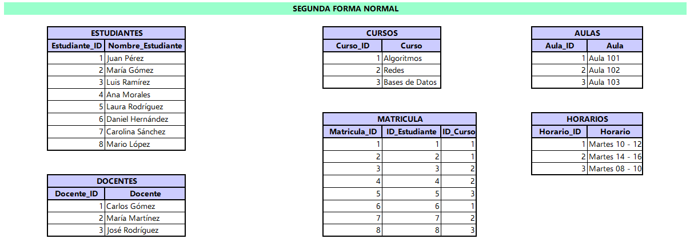

# Taller MySQL - Universidad

## Problema

Una universidad está digitalizando su sistema de gestión de asignaturas, docentes y horarios. Actualmente, la información está registrada en una única tablas, perdo ha generado redundancias y dificultades para mantener los datos actualizados. Se necesita normalizar la Base de Datos para que sea más eficiente y evitar la redundancia de datos.

## Normalización

### Primera Forma Normal (1FN)


La tabla inicial cumple con la Primera Forma Normal, ya que cumple con estos criterios principales:

> * Valores Atómicos: Cada celda contiene un único valor indivisible como listas o arrays dentro de una misma celda.
> * Estructura Tabular: Posee filas y columnas definidas, cada fila representa un registro único, identificado por ```Estudiante_ID```.

Sin embargo, esta estructura genera múltiples redundancias y anomalías.

___

### Segunda Forma Normal (2FN)



El objetivo principal de la 2FN es eliminar la dependencia parcial que ocurre cuando un atributo no clave depende únicamente de una parte de la llave primaria y genera redundancia de datos.

Para que esta estructura cumpla con los criterios de la 2FN se aplicaron las siguientes acciones:

> * Se separa la información personal de los estudiantes en la Tabla *ESTUDIANTES*, donde el atributo _Nombre_Estudiante_ depende únicamente su identificador único (_Estudiante_ID_). Con esto se evita que el nombre del estudiante se repita por cada curso en el que está inscrito.
> * Lso atributos descriptivos del curso (_Curso_, _Aula_, _Horario_) se agruparon en la tabla *CURSOS*, donde dependen directamente de la clave _Curso_ID_.
> * La relación que existe entre la Tabla *ESTUDIANTES* y *CURSOS* es de muchos a muchos (ya que un Estudiante puede estar inscrito en muchos Cursos y un Curso puede tener muchos estudiantes), por lo que genera redundancia en los datos se crea la Tabla *MATRICULA* que asegura que las relaciones se administren de forma eficiente sin dependencias parciales.
> * Se extraen los datos de los profesores a una Tabla *DOCENTES*  para evitar repetir los nombre de los profesores en múltiples registros.

______

### Tercera Forma Normal (3FN)


El objetivo principal de la 3FN Ees eliminar la dependencias transitivas, lo que ocurre cuando atributos no clave dependen de otros que tampoco son clave, en lugar de depender directamente de la llave primmaria.

La estructura de la Base de Datos cumple con esta característica ya que:

> * Se consolida la Tabla *DOCENTES* y se vincula a la Tabla *CURSOS* utilizando _ID_Docente_ como llave foránea.